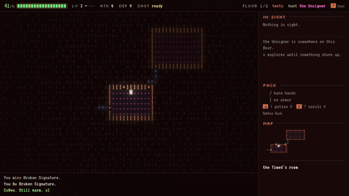
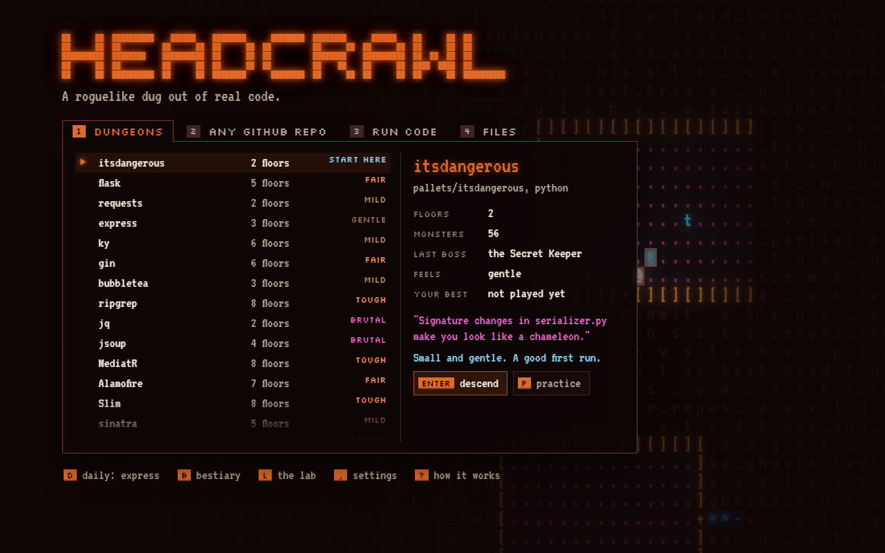
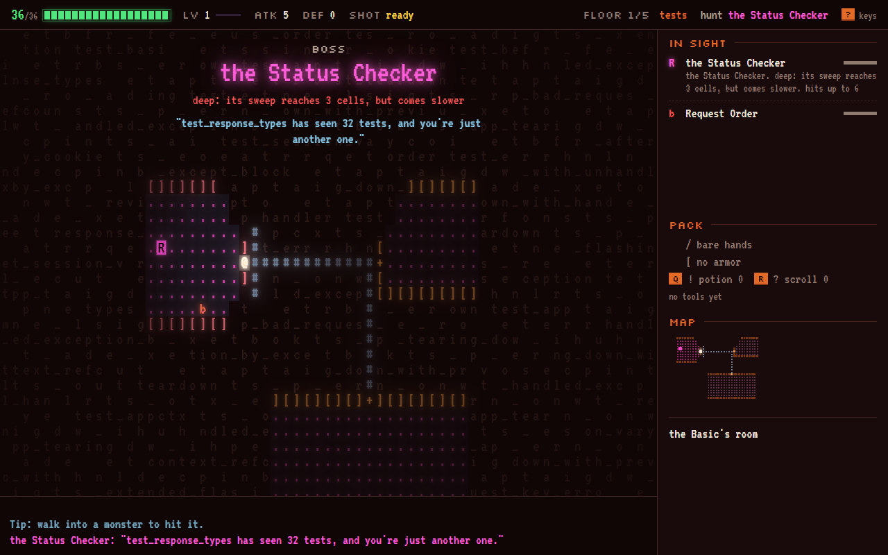
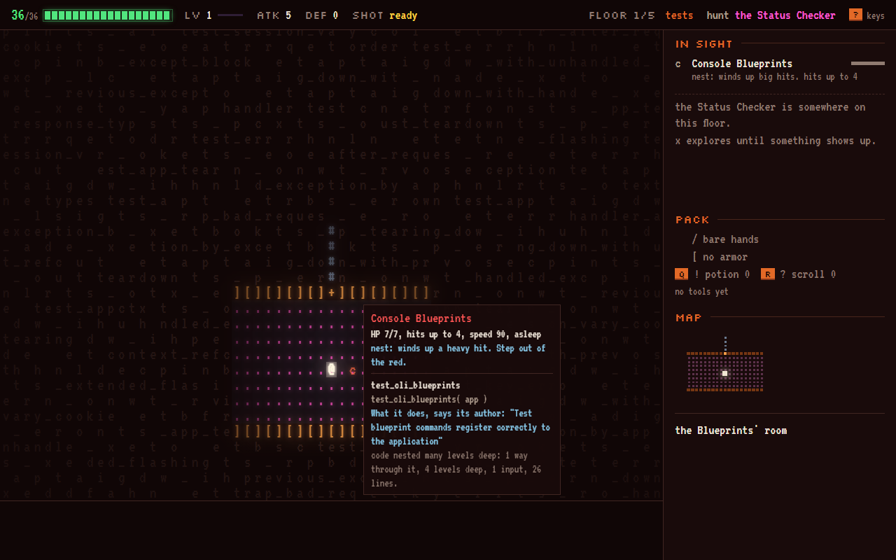

# HEADCRAWL

[](https://github.com/Ferinjoque/headcrawl/actions/workflows/ci.yml)


Every program is a dungeon. This game digs it out and sends you down.



HEADCRAWL is a short roguelike made of glowing text. You go down one floor
at a time, every floor has a boss, and the stairs only open once it's dead.
You get one life. Monsters wind up their big hits where you can see them
coming, potions and scrolls lie around, and every level you pick a new trick.
A run takes ten to twenty minutes.

The twist is where the dungeons come from. Each one is built from the source
code of a real program. Folders turn into floors and files into rooms, and
every monster is a function from that code. `load_payload` comes at you as
the Payload Loader, and the tangled functions nobody wants to touch are the
ones that hit hardest. The boss of each floor is the code that changed the
most and reads the worst.

You don't need to know any code to play. If you do, you'll start recognising
faces, and hovering over any of them shows the real thing.



## Play

Clone it and start it with Node 20 or newer.

```
git clone https://github.com/Ferinjoque/headcrawl.git
cd headcrawl/game
npm ci
npm run dev
```

Then open http://localhost:5173 and pick the dungeon marked start here. It's
small and gentle. Behind the menu a bot is always playing one of the
dungeons, so you can watch for a bit first.

Releases come as a zip with everything built. Unzip it and run
`python play.py` in the folder, and the game opens in your browser with no
Node needed.

## How it plays

Arrows, `hjkl` or `yubn` move you, and walking into a monster hits it. `x`
explores until something shows up, `z` rests, `>` takes the stairs and `f`
shoots a monster up to five cells away for half a hit. `c` shows every
number behind a fight and `?` explains the rest. Red cells on the floor are
where a hit is about to land, so step out of them. A gamepad works too.



| You see | It is | It does |
|---|---|---|
| `!` | potion | heals you when you drink it with `q` |
| `?` | scroll | a random trick when you read it with `r` |
| `%` | curse | more attack and less max HP |
| `/` | weapon | adds to your attack and has a fighting style |
| `[` | armor | takes some damage off every hit |
| `*` | shrine | heals you once |
| `$` | shop | one deal per floor, and every deal costs something |
| `&` | keeper | the person who wrote most of the floor, with coffee |
| `Y` | side door | the same floor from another version of the code |
| `>` | stairs | open once the boss is dead |

The first floor is just fights and loot. The shop, elite monsters and
outdated code that slows you show up on the second floor, keepers and side
doors on the third.

Monsters come in kinds and each one has a tell. Tangles regrow, nests wind up
heavy hits, hydras split in two, walls are armored and slow, imps are fast,
bugs dodge, ghosts drift through walls and remotes shoot down a red line.
Bosses fight in a style that comes from their own code. Deeply nested ones
sweep wider, ones with too many inputs keep calling helpers, the huge ones
heal while you're away and the busy ones speed up as the fight goes on.


You carry one weapon and one armor. A weapon's style comes from the language
of the file it was found in. Rust weapons pierce armor, Go never misses,
Python sweeps everything next to you, JavaScript sometimes swings twice, C
crits hard and bites back on a miss, Java knocks monsters back, Swift heals
on a kill and PHP hits for anywhere from half to double. Bosses drop their
own function as a weapon, so you can beat the Unsigner and walk off with the
Unsigner's Spear.

Level ups offer three of 21 tools like Parry, Last Stand and Second Swing.
Each one is a real thing programmers use underneath, and the card tells you
which if you hover it.

## The code behind it

Hover over (or tap) a monster and the tip shows what you're fighting first,
then the code it came from. You get the real function name and how it's
called, what its author wrote it does when there's a docstring or comment,
and how it's built in plain words. You can play the whole game without ever
reading it. It's there for when you're curious.



Programmers who want the raw version everywhere can set code details to
everywhere in settings (`,`). Then the panel, the log and the cards show real
names, file paths, line numbers, commits and the git jokes.

| In the code | In the dungeon |
|---|---|
| folder | floor, with the code everything relies on at the bottom |
| file | room, sized by its lines |
| one file importing another | `~` corridor |
| an import cycle | a loop corridor that walks you back once |
| function | monster, named after what it does |
| paths through it, nesting, inputs | HP, damage, speed |
| test file | shrine |
| `TODO` | potion |
| `FIXME` | weapon |
| `HACK` | scroll |
| `XXX` | curse |
| tests or error handling around a function | armor |
| most changed and most tangled | the boss |
| the floor a year ago | what a time slips scroll turns it back into |
| whoever committed most to a folder | the keeper |
| dependencies | what the shop sells |
| a function marked deprecated | outdated, and its hits slow you |
| a merge conflict left in a file | a room where both versions fight you |
| a file someone reverted | a monster that comes back once |
| other branches | side doors |
| a function nothing calls | ghost |
| a small function that talks to the network | remote |

Even the rock between rooms is made of the floor's own identifiers.

## Your own repo

Paste any public GitHub repo on the title screen and the game builds its
dungeon right there in the tab. The same Python analyzer runs in your browser
through Pyodide, the files come straight from GitHub and nothing in the repo
ever runs. It takes under a minute. This needs [uv](https://docs.astral.sh/uv/)
and one extra step after `npm ci`.

```
npm run py
```

You can also open a folder from your own disk on the title screen, and it
never leaves your machine. Give a repo and an old tag and you get then vs
now, both versions built side by side with what grew, what got simpler and
which notes appeared, and you can play either one.

The command line version reads the full git history, so every TODO knows how
old it is and who left it, and other branches become side doors.

```
cd analyzer
uv run headcrawl play pallets/flask
uv run headcrawl play ../path/to/your/repo
```

A dungeon carries names, notes and a few lines of code from the repo it came
from, so think twice before sharing one built from private code.

## Runs you can share

The same code always builds the same dungeon. A run code like `flask-4821`
gives a friend your exact game down to every roll, and a link from the end
screen lets them race your run as a faint second @ next to theirs. You can
also save a GIF of your last turns, a replay, or the whole run as text.

There's a daily run that's the same for everyone, a bestiary that fills up as
you meet things, twelve trophies, and harder levels that unlock one at a time
once you clear the one before. The music is made live in the browser for each
dungeon, gets darker the deeper you go and brings the drums in when something
wants you dead.

The lab (`l` on the title) lets you set up any fight you want. Spawn any
monster or boss, hand yourself any weapon or tool and try things out.

## Built with

The analyzer is Python 3.12 with lizard for complexity, tree-sitter for
comments and imports, git for history and Pydantic for the output. The game
is TypeScript on Vite with rot-js and its own glowing canvas renderer. A JSON
schema generated from the analyzer's models keeps the two in step. Tests
cover both sides, and a bot plays every built-in dungeon in them.

```
cd analyzer && uv run pytest
cd game && npm test && npx playwright test
```

`scripts/gallery.sh` rebuilds the built-in dungeons, and `npm run sim` in
`game/` has two bots play all of them and prints how they did.

## Credits

The built-in dungeons come from these open source projects, each quoting
small parts of its code under its own license.
[itsdangerous](https://github.com/pallets/itsdangerous),
[flask](https://github.com/pallets/flask),
[click](https://github.com/pallets/click),
[requests](https://github.com/psf/requests),
[express](https://github.com/expressjs/express),
[ky](https://github.com/sindresorhus/ky),
[chalk](https://github.com/chalk/chalk),
[gin](https://github.com/gin-gonic/gin),
[bubbletea](https://github.com/charmbracelet/bubbletea),
[cobra](https://github.com/spf13/cobra),
[ripgrep](https://github.com/BurntSushi/ripgrep),
[axum](https://github.com/tokio-rs/axum),
[jq](https://github.com/jqlang/jq),
[jsoup](https://github.com/jhy/jsoup),
[moshi](https://github.com/square/moshi),
[Polly](https://github.com/App-vNext/Polly),
[Alamofire](https://github.com/Alamofire/Alamofire),
[Slim](https://github.com/slimphp/Slim) and
[sinatra](https://github.com/sinatra/sinatra).
Boss lines were written from that code by a model running locally.

The fonts are [VT323](https://fonts.google.com/specimen/VT323) and
[Silkscreen](https://fonts.google.com/specimen/Silkscreen), both under the
SIL Open Font License.

HEADCRAWL's own code is MIT licensed.
