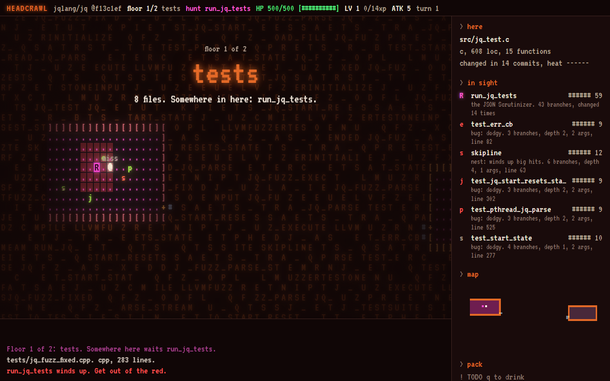

# HEADCRAWL

A roguelike dug out of real code.


You go down a dungeon one floor at a time. Each floor has a boss, and the
stairs only open once it's dead. You get one life. Monsters wind up big hits
you can see coming, potions and scrolls are scattered around, and every few
levels you pick a new trick.

The twist is where the dungeons come from. Each one is built from the
source code of a real program: folders become floors, files become rooms,
and every monster is a function from that code, named after it. The
tangled, hard-to-follow ones are the tough ones. You don't need to know any
code to play. If you do, you'll recognise a few faces.

Same code, same dungeon. A run code like `flask-4821` gives a friend your
exact game, down to every roll.


## Running it

The quickest way: grab the zip from the latest release, unzip it, and run
`python play.py` inside the folder. It serves the game on 127.0.0.1 and
opens your browser.

From source you need Node 20 or newer.

```
git clone <this repo>
cd headcrawl/game
npm ci
npm run dev          # then open http://localhost:5173
```

That's enough for the twenty bundled dungeons, daily runs and run codes. To
build a dungeon from any GitHub repo on the title screen you also need
[uv](https://docs.astral.sh/uv/), once:

```
npm run py           # builds the analyzer and fetches Python for the browser (about 30 MB)
```

## Playing

Pick a dungeon from the list (the one marked "start here" is small and
gentle). Behind the menu a bot plays a random one, so you can see what
you're in for.

Arrows, `hjkl` or `yubn` move, and walking into a monster attacks it. `x`
explores until something shows up, `z` rests, `>` takes the stairs once the
boss is dead, `f` shoots a monster up to 5 cells away for half a hit, `c`
shows your stats and gear, `?` explains everything else. Red cells on the
floor are where a hit is about to land: step out. A gamepad works too:
d-pad or stick moves, A confirms, B backs out, Back lists the rest.

| You see | It is | It does |
|---|---|---|
| `!` | potion | heals, `q` drinks one |
| `?` | scroll | a random trick, `r` reads one |
| `%` | curse | attack up, max HP down |
| `/` | weapon | adds to your attack and fights like its language |
| `[` | armor | takes some damage off every hit |
| `*` | shrine | heals you once |
| `$` | shop | one buy per floor; every deal helps and every one costs |
| `&` | keeper | say hi once for a coffee |
| `Y` | side door | another version of the floor: no boss, a weapon by the stairs |
| `>` | stairs | open once the boss is dead |

The first floor is just fights and loot. The shop, elite monsters and
outdated code that slows you come in on the second floor, keepers and side
doors on the third. Hard runs and the last floor have everything.

Monsters come in kinds, and each has a tell:

| Kind | What it does |
|---|---|
| tangle | regrows HP every turn, finish it fast |
| nest | winds up a heavy hit, step out of the red |
| hydra | splits in two the first time it's hurt |
| wall | armored and slow |
| imp | fast |
| bug | dodges now and then |
| ghost | drifts through walls, hits softly |
| remote | shoots along a red line from 4 cells away |
| boss | area attacks; each one has a style: deep ones sweep wider, crowded ones call helpers, huge ones heal out of reach, hot ones speed up |

One monster in a busy room can be an elite, drawn bold on a faint tile:
tougher, worth more, and more likely to drop gear. A struck-through monster
is outdated and its hits slow you. One with a small mark at its top right
has been reverted before: the first time it dies, it comes back at half HP.
Hover a boss (or meet it) to see the first lines of its actual code.



### Gear and tools

You carry one weapon and one armor. A weapon fights the way the language of
its file does:

| Language | Trait | |
|---|---|---|
| Rust | borrow checked | ignores armor |
| Go | boring | never misses |
| Python, Ruby, Lua | duck typed | half damage to everything else next to you |
| JavaScript, TypeScript | async | one swing in four takes no time |
| C, C++ | unsafe | crits hit three times as hard, a miss costs 1 HP |
| Java, Kotlin, C#, Scala | enterprise | +1 damage and knocks back |
| Swift | ref counted | every kill heals 2 |
| PHP | loosely typed | hits for half to double |

Walking onto gear with that slot full asks before swapping. `c` (or
clicking atk in the top line) shows every number behind a fight.

Level ups offer three of 21 tools named after things programmers use
(linter, rubber duck, feature flag...); each card says what it does in the
game and, in small print, what the real thing is. The rare ones come up a
third as often.

### Daily runs, saves and sharing

There is a daily run (`d`): same dungeon, same rolls and the same twist for
everyone that day. Only your first start of the day counts.

Runs save themselves in the browser; close the tab and pick it up later
under "continue". When a run ends you can copy a spoiler-free result, and
under `tab`: a race link (your run plays as a faint @ next to theirs), a
replay link, a GIF or an asciinema cast of the last turns, or the whole
run log as text. Your own best run on each dungeon comes back as a ghost to
race. Links point at your own copy, so a friend pastes them into the run
code box on theirs.

`b` on the title opens the bestiary: every kind of monster, elite and
weapon you've met, what keeps getting you, and twelve trophies (clear a
dungeon bare-handed, carry three curses to the bottom, beat 100 monsters in
a run...) with what each one takes.

Difficulty is in settings: story, normal or hard. Clearing a dungeon on
hard unlocks hard 2 (potions heal half), then hard 3 (bosses tougher and
faster), then hard 4 (you heal half as fast), each on top of the last. The
level is part of the run code: `flask-4821-hard3`.

The music is made live in the browser and is different for every dungeon.
It gets darker the deeper you go and drums come in when something wants
you dead. `m` mutes; `,` opens settings (music on its own, difficulty,
text size, colorblind friendly or high contrast colors, calm motion). On a
phone, tap a monster to see what it is.

## How code becomes a dungeon

For the curious. Every number in the game comes from the code:

| In the code | In the dungeon |
|---|---|
| folder | floor, ordered so the code everything else relies on is at the bottom |
| file | room, sized by lines of code |
| one file importing another | `~` corridor |
| an import cycle | `o~` loop corridor that walks you back once |
| neighbours in the folder tree | `#` passage |
| function | monster named after it |
| complexity (paths through it) / nesting / parameters | HP / damage / speed |
| test file | shrine |
| `TODO` | potion |
| `FIXME` | weapon |
| a test file's suite, or the error handling around a function | armor |
| a beaten boss | drops its own function as a weapon |
| `HACK` | scroll |
| `XXX` | curse |
| most changed x most complex | the boss of the floor |
| the floor a year ago | what a "time slips" scroll turns it back into |
| whoever committed most to a folder | the keeper on that floor |
| dependencies in the root manifest | what the shop sells |
| who last touched a TODO line | written on the loot ("a TODO from 2012 by alice") |
| a function marked deprecated | outdated, struck through; its hits slow you |
| a merge conflict committed into a file | a room walled in `<<<` and `>>>` where both versions fight |
| commits titled "Revert ..." that touched a file | its toughest monster comes back once |
| the boss function's first lines | shown on its card |
| the repo's other branches (command line builds) | side doors |
| god function / deeply nested / hot path | huge / deep / hot elites and boss styles |
| a function nothing mentions, tests included | ghost |
| a small function that calls the network | remote |

The rock between rooms is filled with the floor's own identifiers.

## Your own repo

Paste any public GitHub repo on the title screen and the game builds the
dungeon right there: the same Python analyzer runs in your browser through
Pyodide, files come straight from GitHub, and nothing in the repo is ever
executed. It takes about ten seconds and a handful of GitHub's 60 hourly
anonymous API calls (it needs `npm run py` once, see above). Its run code
(`owner/repo@commit-1234`) rebuilds the same dungeon for anyone.

Optionally, add your own GitHub token in settings (`,`). GitHub then allows
5000 calls an hour instead of 60, and browser builds show the year each
TODO was written, using GitHub's blame. A fine-grained token with read-only
access to public repos is enough. It stays in your browser, for the tab
unless you tick "remember", and is only ever sent to api.github.com. Dates
are text only, so a link builds the same dungeon with or without a token.

Or pick a folder on your own disk (title screen, files tab): the same
analyzer reads it in the tab, and nothing is uploaded.

Give a repo and an old tag instead and you get **then vs now**: both
versions built and compared, which functions grew, which got simpler, which
notes appeared, and you can play either one.

The command line version reads the full git history, so every TODO also
knows how old it is, and other branches become side doors. `headcrawl play`
builds a dungeon and opens it in the game in one go (from source, run
`npm run build` in `game/` once):

```
cd analyzer
uv run headcrawl play pallets/flask
uv run headcrawl play ../path/to/repo
```

Or just the dungeon file:

```
cd analyzer
uv run headcrawl prefetch          # once: tree-sitter grammars
uv run headcrawl analyze ../path/to/repo -o mine.json
uv run headcrawl analyze pallets/flask -o flask.json
```

Open the game and press `o`, or drop the file on it. The game turns it into
a link you can send; the whole dungeon lives in the part of the URL after
`#`.

`--flavor` asks a local Ollama model (default `qwen2.5:7b`) for boss titles
and taunts. It only keeps lines that talk about the actual function, checks
first that the model follows prompts at all, and falls back to the built-in
lines otherwise. Off by default, and the game never needs it.

## The lab, practice runs and the sim

`l` on the title opens the lab: a small two-floor dungeon with a tools
panel over the map. Spawn any monster kind, as an elite or outdated, a
boss of each style, hand yourself any weapon, armor or tool, turn on god
mode, freeze the floor, reveal it, open the stairs. `` ` `` hides the panel.
`p` on a dungeon (or `?practice=1` on any link) starts a practice run with
the same tools: it never saves and never counts toward records, the
bestiary or the daily.

For balance work, `npm run sim` in `game/` plays the gallery with two bots
(one takes whatever comes first, one chooses like a person would) and
prints wins, floors, levels, kills, turns and killers per dungeon.
`SIM_DUNGEONS=flask,axum`, `SIM_RUNS=10`, `SIM_STYLE=careful` and
`SIM_LEVEL=hard` narrow it down.

## How it's built

- `analyzer/` Python 3.12. lizard for complexity, tree-sitter for comments
  and imports, git for churn, Pydantic for the output. Clones are shallow,
  partial, https only, with hooks and every config-driven command turned off.
- `game/` TypeScript, Vite and rot-js. Canvas renderer with bloom, seeded
  layout that places files next to the files they import, a bot that plays
  every gallery dungeon in the tests. Everything the game calls things, in
  plain words, is in `game/src/ui/glossary.ts`.
- `schema/` the JSON contract between the two, generated from the Pydantic
  models. The game's types and validator are generated from it.
- `docs/` plan, research notes and progress.

```
cd analyzer && uv run pytest --cov
cd game && npm test && npx playwright test
```

## Adding to the gallery

`scripts/gallery.sh` rebuilds the bundled dungeons. Add a repo to its list,
run it, and `npm run gallery` refreshes the index.

## License

MIT
